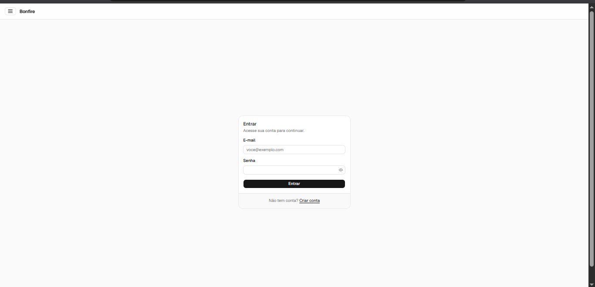
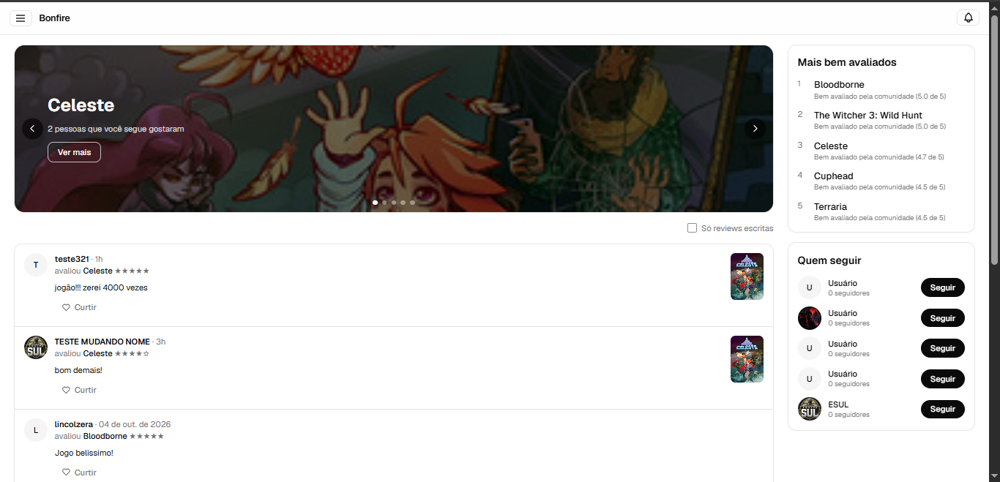
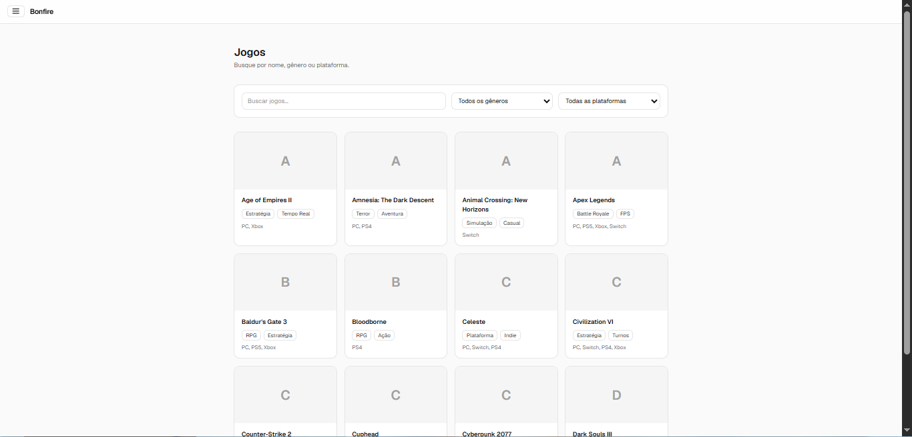
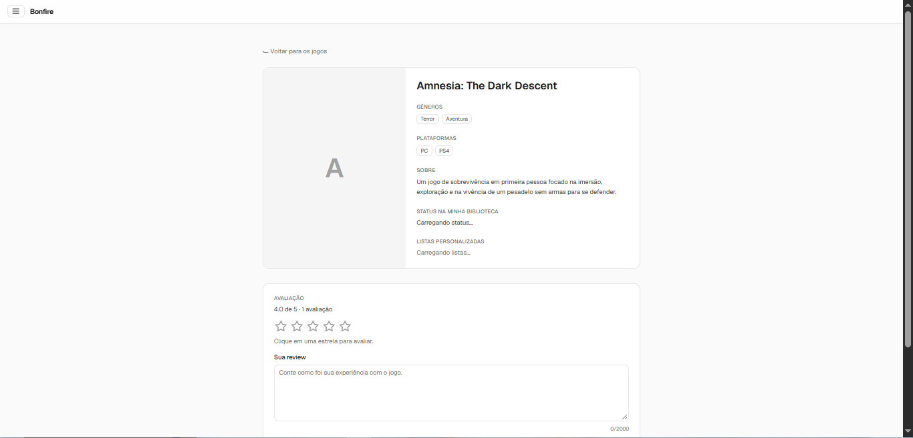
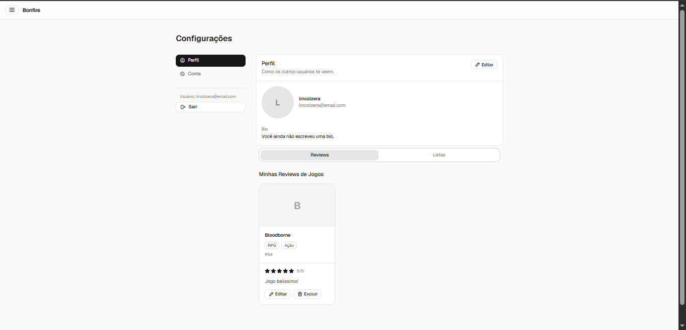
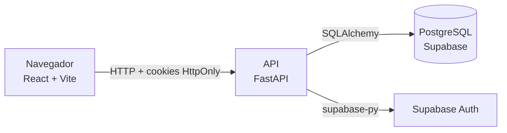
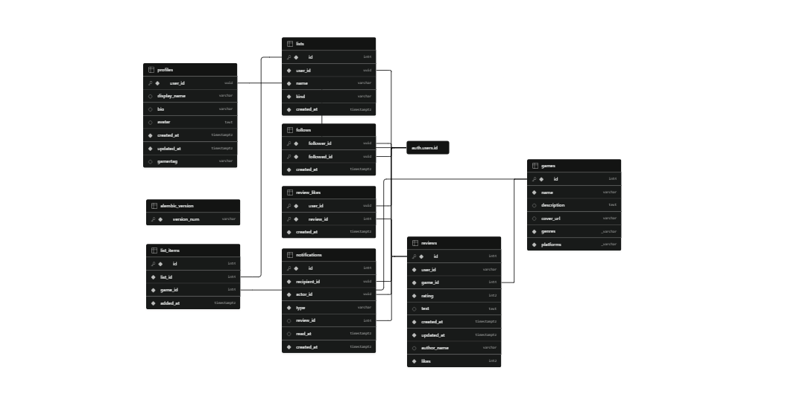

<div align="center">

# 🔥 Bonfire

**Sua fogueira para falar de jogos.**


</div>

O **Bonfire** é uma rede social de avaliação de jogos. O jogador descobre títulos por nome, gênero ou plataforma, avalia com estrelas, escreve reviews, organiza o que já jogou e o que pretende jogar em listas, segue outros jogadores, acompanha um feed com a atividade deles e recebe recomendações de jogos.

Projeto desenvolvido no Lab de Engenharia de Software (ADS) da Fatec São José dos Campos.

## Telas

| Login | Feed |
| :---: | :---: |
|  |  |
| **Catálogo de jogos** | **Detalhes do jogo** |
|  |  |
| **Perfil** | |
|  | |

## Funcionalidades

### Requisitos funcionais

| Código | Requisito | Status |
| ------ | --------- | :----: |
| RF01 | Publicar avaliações de jogos com estrelas e resenhas detalhadas | ✅ |
| RF02 | Personalizar o perfil com "Jogados" e "Pretendo Jogar" | ✅ |
| RF03 | Seguir outros usuários e interagir no feed social (perfil público, feed e curtidas em reviews) | ✅ |
| RF04 | Recomendações de jogos baseadas em preferências e avaliações | ✅ |

Também incluídos: cadastro e login, busca por nome, gênero e plataforma, página de detalhes, edição e exclusão das próprias reviews, listas personalizadas e edição dos dados da conta.

### Requisitos não funcionais

| Código | Requisito | Como é atendido | Status |
| ------ | --------- | --------------- | :----: |
| RNF01 | BD relacional | PostgreSQL com chaves estrangeiras (exclusão em cascata), índices e restrições `UNIQUE` e `CHECK` | ✅ |
| RNF02 | Design Patterns | **Strategy** nas recomendações. **Observer** previsto para as notificações | Strategy ✅ · Observer ✅ |
| RNF03 | Desempenho do feed | Feed e catálogo paginados, busca com espera de 300 ms entre as teclas e índices nas colunas de junção | ✅ |
| RNF04 | React SPA | Página única com React Router. Notas, reviews, listas e feed atualizam sem recarregar | ✅ |

Além disso: sessão por cookies `HttpOnly`, CORS restrito ao front, validação com Zod (front) e Pydantic (back), navegação por teclado e layout responsivo.

### Próximos passos

- [ ] Comentários nas reviews
- [ ] Notificações com o padrão **Observer**
- [ ] Testes automatizados de jogos, reviews, conta e feed
- [ ] Deploy do front e da API

## Tecnologias

| Camada | Tecnologias |
| ------ | ----------- |
| Frontend | React, TypeScript, Vite, React Router, Tailwind CSS, shadcn/ui, React Hook Form, Zod |
| Backend | Python, FastAPI, SQLAlchemy 2, Alembic, Pydantic |
| Dados e autenticação | PostgreSQL e Supabase Auth |
| Ferramentas | uv, Pytest, Git e GitHub |

## Arquitetura



O front conversa só com a API. A API acessa o banco e o Supabase Auth, e o navegador nunca vê as chaves do Supabase.

### Banco de dados



| Tabela | Descrição |
| ------ | --------- |
| `games` | Catálogo, com gêneros e plataformas em listas de texto (minúsculas e sem acento) |
| `reviews` | Nota (1 a 5) e review opcional, uma linha por par `user_id` e `game_id` |
| `review_likes` | Curtidas nas reviews |
| `profiles` | Nome de exibição, bio, foto e gamertag |
| `lists` e `list_items` | Listas personalizadas e seus jogos |
| `follows` | Quem segue quem, sem permitir seguir a si mesmo |
| `Notifications` | Notificações recebidas pelo usuário |

`auth.users` pertence ao Supabase Auth. Em `reviews`, o `user_id` guarda o id do usuário, sem chave estrangeira.

### Backend (`backend/app`)

- `routers/`: endpoints HTTP, agrupados em `api.py`
- `schema/`: modelos Pydantic de entrada e saída
- `models/`: tabelas (SQLAlchemy)
- `services/`: integração com o Supabase Auth e o motor de recomendação
- `db/` e `dependencies.py`: sessão do banco e identificação do usuário logado

**Autenticação:** a API valida o login no Supabase Auth e grava os tokens em cookies `HttpOnly`. As rotas protegidas leem o cookie pela dependência `get_current_user` e respondem `401` sem sessão válida.

**Recomendação (Strategy):** a interface `RecommendationStrategy` tem quatro estratégias intercambiáveis (quem você segue, gosto parecido, gênero favorito e mais bem avaliados), além de uma composta que as combina. O `RecommendationContext` escolhe a estratégia e monta o perfil de preferências do usuário.

### Frontend (`frontend/src`)

- `pages/`: uma tela por rota
- `features/`: fluxos completos (`auth`, `profile`, `reviews`, `account`)
- `components/`: componentes reutilizáveis
- `lib/`: cliente HTTP e chamadas da API
- `router.tsx`: rotas. Principais: login (`/`), feed (`/feed`), catálogo (`/bonfirehub`), jogo (`/jogos/:id`), perfil público (`/u/:gamertag`) e configurações (`/settings`). As páginas que exigem login usam o loader `requireSession`.

## Como rodar localmente

**Pré-requisitos:** Python 3.12+, [uv](https://docs.astral.sh/uv/), Node.js 20+ e um projeto no [Supabase](https://supabase.com).

```bash
git clone <URL-DO-REPOSITORIO>
cd <PASTA-DO-REPOSITORIO>
```

**Backend**

```bash
cd backend
cp .env.example .env        # no Windows: copy .env.example .env
```

Preencha o `.env` (veja a seção seguinte) e rode:

```bash
uv sync
uv run alembic upgrade head              # cria as tabelas
uv run uvicorn app.main:app --reload     # sobe a API
```

A API fica em `http://localhost:8000` e a documentação interativa (Swagger), com todos os endpoints, em `http://localhost:8000/docs`.

**Frontend** (em outro terminal)

```bash
cd frontend
npm install
```

Crie o `frontend/.env`:

```env
VITE_API_URL=http://localhost:8000
```

```bash
npm run dev
```

A aplicação abre em `http://localhost:5173`.

> **Dica:** a tabela `games` começa vazia. Cadastre jogos pelo SQL Editor do Supabase ou com um script de carga.

## Variáveis de ambiente

Os valores nunca vão para o Git: só o `.env.example` fica no repositório.

**Backend (`backend/.env`)**

| Variável | Obrigatória | Descrição |
| -------- | :---------: | --------- |
| `DATABASE_URL` | Sim | Conexão do Postgres: `postgresql+psycopg://postgres.<ref>:<senha>@<host>:5432/postgres`. Use o **Session pooler** do Supabase (botão *Connect*) |
| `SUPABASE_URL` | Sim | URL do projeto Supabase |
| `SUPABASE_ANON_KEY` | Sim | Chave pública (*anon* ou *publishable*) |
| `FRONTEND_URL` | Sim | Origem do front, usada no CORS (`http://localhost:5173`) |
| `AUTH_COOKIE_SECURE` | Não | `false` em desenvolvimento e `true` em produção (HTTPS) |
| `SECRET_KEY` | Não | Chave da aplicação (há um valor padrão para desenvolvimento) |
| `SUPABASE_SERVICE_ROLE_KEY` | Não | Chave de administrador. Se informada, a troca de e-mail é aplicada na hora, sem link de confirmação. **Nunca** compartilhe nem commite |

**Frontend (`frontend/.env`):** `VITE_API_URL`, com a URL da API.

## Testes

```bash
cd backend
uv run pytest
```

Cobertura atual: autenticação (`test/test_auth.py`).

## Fluxo de trabalho da equipe

- **Branches:** uma por requisito, como `feature/REQ-05-Busca-jogos`.
- **Commits:** [Conventional Commits](https://www.conventionalcommits.org/pt-br/), por exemplo `feat(backend): adiciona busca de jogos`.
- **Pull Requests:** descrição da atividade, como testar e o resultado esperado.
- **Migrations:** uma por mudança no banco, e migration já aplicada não é editada. Antes de gerar uma, rode `git pull` e confira com `uv run alembic heads` que existe um único head.

## Equipe

| Nome | Papel | GitHub |
| ---- | ----- | ------ |
| Lincoln Borsoi Moreira | Desenvolvedor | [@Dollar2006](https://github.com/Dollar2006) |
| João Alvaro | Desenvolvedor | [@JoaoAlv4ro](https://github.com/JoaoAlv4ro) |
| Guilherme Caçula | Desenvolvedor | [@usuario](https://github.com/usuario) |

---

<div align="center">

Projeto desenvolvido no Lab de Engenharia de Software · Fatec São José dos Campos

</div>
